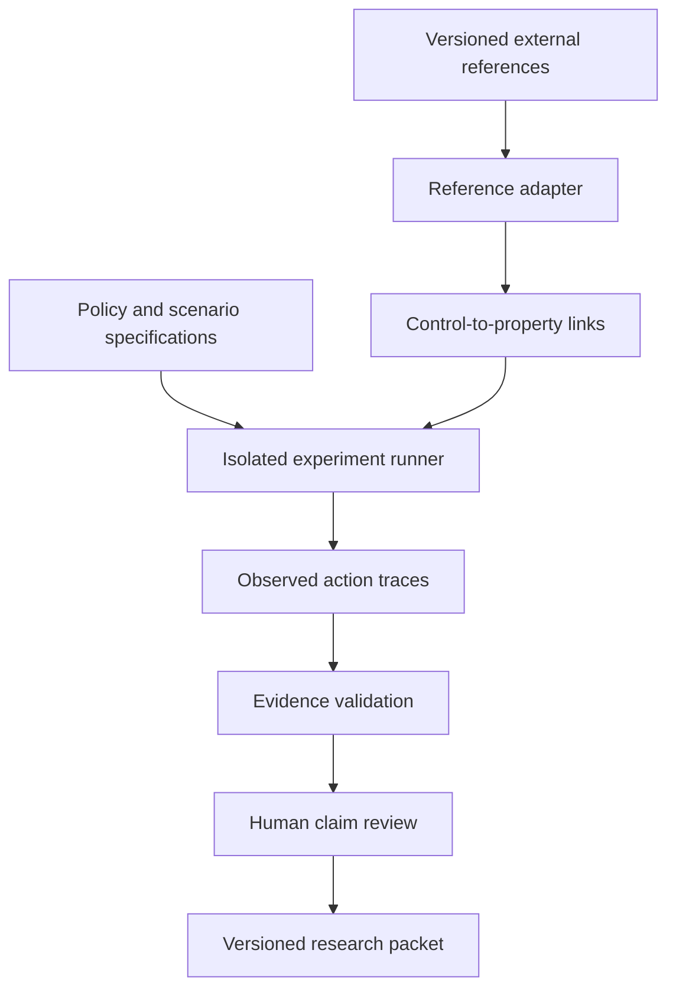

# Mission Assurance Workbench

**Working title:** descriptive project name, not a cleared commercial trademark.  
**Status:** research platform concept with an offline prototype; production architecture and external integrations are proposed.  
**Independence:** a StephSec research proposal. No partnership or endorsement by Edward Lee, AIDEFEND Labs, or another institution is claimed.

## Product question

When an AI-assisted security workflow produces a recommendation or takes an action, can a reviewer determine what it was allowed to do, which evidence it used, what actually happened, and what the result does—and does not—establish?

The workbench is designed around a chain of explicit relationships:

**Versioned defense reference → local security requirement → scenario → action trace → result → reviewed claim.**

References identify relevant knowledge. Local requirements specify intended behavior. Scenarios supply conditions. Traces record observations. Reviewers decide which claims the evidence supports. None of these steps should automatically stand in for another.

## First user journey

1. A researcher chooses a synthetic evidence-handoff scenario and its declared policy.
2. The researcher selects an AIDEFEND reference version or runs without external mappings.
3. An isolated runner evaluates a baseline and a proposed control configuration against identical tasks.
4. The workbench displays both policy outcomes and legitimate task outcomes.
5. A reviewer inspects the source versions, trace, missing observations, and limitations.
6. The reviewer exports a reproducible evidence packet for a research note. Publication is a separate decision.

## Intended architecture

The diagram is a target architecture, not a depiction of a deployed service. The initial local prototype validates and reports supplied synthetic traces; it does not call an AI provider or perform the full experiment loop.

## Modules and boundaries

| Module | Responsibility | Must not imply |
| --- | --- | --- |
| Reference adapter | Load a pinned, checksummed control snapshot and preserve licensing metadata | Reference relevance equals control effectiveness |
| Policy layer | Describe permitted actions, data domains, approvals, and revocation | A language model's explanation is enforcement |
| Scenario runner | Execute authorized synthetic tasks in isolated environments | A simulator reproduces every production condition |
| Trace collector | Record decisions, actions, state changes, and missing events | A hash proves truthful collection or origin |
| Outcome evaluator | Separate completion, violation, denial, and unknown outcomes | No observed violation means complete security |
| Reviewer interface | Record judgments, exclusions, evidence gaps, and amendments | Automated certification or legal admissibility |

## Reference integration contract

Use AIDEFEND's `data/integration/manifest.json` and generated export as the proposed import boundary. Record repository, commit, framework edition, schema version, control ID, source checksum, and local mapping rationale. Verify hashes before import. Reject unknown mandatory schema changes; tolerate additive optional fields only under a documented compatibility rule.

Do not scrape an unversioned browser view to manufacture a control inventory. Do not count parent navigation families as implemented controls. When an upstream mapping changes, preserve the prior assessment and create a new review task rather than silently changing its conclusion.

AIDEFEND software and content have different license terms; [source notes](../docs/source-notes.md) identify the inspected files. The prototype does not bundle an upstream control catalog or claim an active MCP integration.

## Evidence record requirements

The intended research record includes:

- Scenario, policy, runner, and evaluator versions.
- Synthetic or real-data declaration and permitted use.
- Actor, principal, action, object, data domain, approval, and time ordering.
- Environment and model configuration, if a model is actually used.
- Expected behavior and observed behavior, including missing observations.
- Legitimate task completion independently of policy enforcement.
- External mapping provenance and reviewer decisions.
- Collection limitations, excluded failures, and reproduction instructions.

These are target requirements. Consult the prototype's schema documentation for the fields currently implemented; future fields must not be represented as available today.

## Initial scope

**Included now:** a local deterministic demonstration and a proposed evaluation protocol.

**Next implementation:** a versioned reference importer, isolated action simulator, and reproducible fixture generation.

**Later, separately reviewed:** real model adapters, benchmark adapters, storage of sensitive traces, multi-user access, human-subject research, and deployment.

No autonomous response against third-party systems, personnel profiling, operational military decision-making, or live botnet interaction is part of the MVP.

## Milestones with exit criteria

| Stage | Deliverable | Exit criterion |
| --- | --- | --- |
| M0: local baseline | Fixture evaluator, documented limitations, negative tests | Valid fixtures report deterministically; malformed evidence cannot silently pass |
| M1: provenance adapter | Pinned AIDEFEND import and local property mappings | Checksum/schema failures rejected; IDs preserve source edition; no unsupported control credit |
| M2: controlled experiments | Isolated bilingual evidence-handoff tasks | Baseline and controls share task fixtures; both security and utility are reported |
| M3: research validation | Preregistered evaluation and independent review | Claims trace to observations; reviewer disagreement and failed experiments are reported |
| M4: collaboration | Agreed upstream/downstream interface and contribution | Maintainers explicitly accept the scope; authorship and licensing are agreed |

These are sequencing gates, not promised delivery dates or commitments from collaborators.

## Place within StephSec research

This workbench is one platform hypothesis within an evolving research program. It brings assurance, intelligence analysis, evidence handling, and AI security together where they share a testable problem. Other studies may produce policy analysis, measurement methods, teaching tools, formal models, or separate platforms.

Research can branch in both directions. A failed authorization check can motivate a security-model revision; a provenance gap can motivate forensic research; a useful technical control can expose a usability or governance problem; a regional measurement limitation can change the design of a broader experiment. The [research map](../research/map.md) makes these connections explicit without treating the current platform as a boundary around the research interests.

Potential workbench extensions include privacy-aware evidence release, human approval behavior, resilient incident handoffs, and evaluation of agent decisions under incomplete observations. Each extension needs its own scope, protocol, and evidence before becoming a product claim.

The technical specifications remain in [security-modeling](https://github.com/secsar/security-modeling). Threat scenarios remain in [threat-modeling](https://github.com/secsar/threat-modeling). This repository owns the research questions, experimental design, and evidence interpretation.
